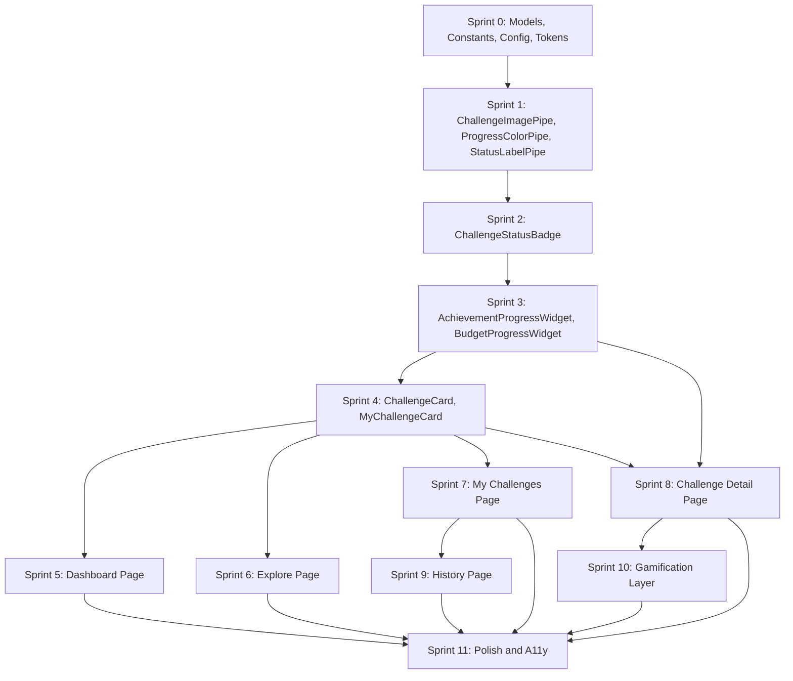

# EcoTrack User Challenge Module V2 — Sprint Execution Guide

**Classification:** Engineering Execution Blueprint  
**Audience:** Frontend Developers, AI Implementation Agent, Tech Lead, QA Team  
**Version:** 1.0 Final — Ready for Execution  
**Based On:** V2 Specification · Master Execution Plan · UI/UX Design Blueprint · Architecture Audit · Live Codebase Analysis  

> **How to use this document:** Execute sprints in order. Do not skip. Each sprint's "Files to Create" and "Files to Modify" sections are complete — no architectural decisions are left to the implementer. Mark each acceptance criterion before closing a sprint.

---

## 1. Sprint Roadmap Overview

| Sprint | Name | Focus | Depends On |
| :--- | :--- | :--- | :--- |
| **Sprint 0** | Architecture Preparation | Models, constants, config, routes, tokens | None |
| **Sprint 1** | Shared Pipes & Utilities | Three Angular pipes + status constants | Sprint 0 |
| **Sprint 2** | Status Badge Component | StatusBadge + shared folder structure | Sprint 1 |
| **Sprint 3** | Progress Widgets | Achievement + Budget widgets (full + mini) | Sprint 2 |
| **Sprint 4** | Challenge Cards | ChallengeCard + MyChallengeCard | Sprint 3 |
| **Sprint 5** | Dashboard Rebuild | Full dashboard page rebuild | Sprint 4 |
| **Sprint 6** | Explore Challenges Rebuild | Explore / list page rebuild | Sprint 4 |
| **Sprint 7** | My Challenges Rebuild | My challenges tabbed page rebuild | Sprint 4 |
| **Sprint 8** | Challenge Detail Rebuild | Complete detail page rebuild | Sprint 3 + 4 |
| **Sprint 9** | History Page | New history route + history card | Sprint 7 |
| **Sprint 10** | Gamification Layer | Milestone toasts + leaderboard widget | Sprint 8 |
| **Sprint 11** | Polish & Accessibility | Mobile, ARIA, reduced motion, regression | All |

---

## 2. Sprint Specifications

---

### SPRINT 0 — Architecture Preparation

**Objective:** Establish the shared folder structure, lock TypeScript models, create constants and config files, add design tokens to the global stylesheet, and register the new History route. No visual UI is built. This sprint creates the foundation that prevents every form of technical debt identified in the audit.

**Why this sprint exists:** The V1 codebase has `MyChallengeDisplay` defined in two separate component files, `CHALLENGE_TYPES` buried inside the Admin module, `resolveImageUrl` copy-pasted in five files, and status strings hardcoded as raw strings throughout templates. Every problem traced back to missing shared infrastructure. Sprint 0 fixes the root cause before any UI work begins.

---

#### Features Built

1. **Shared challenges folder structure** — Create the `challenges/shared/` directory hierarchy
2. **`challenge.models.ts` model audit and additions** — Export `ChallengeEvaluationType` union type + `MyChallengeEntry` interface
3. **`challenge-status.constants.ts`** — A single source-of-truth file for all status string constants
4. **`challenge-type.config.ts`** — Move `CHALLENGE_TYPES` from Admin to shared location
5. **CSS Design Tokens** — Add V2 tokens to `styles.css` under a namespaced block
6. **New `challenges/history` route** — Register the route in `app.routes.ts` (component created in Sprint 9)
7. **Admin module import fix** — Update Admin module to import `CHALLENGE_TYPES` from new shared location

---

#### Files to Create

```
frontend/src/app/components/challenges/shared/
frontend/src/app/components/challenges/shared/pipes/
frontend/src/app/components/challenges/shared/components/
frontend/src/app/components/challenges/shared/components/progress/
frontend/src/app/components/challenges/shared/constants/
frontend/src/app/components/challenges/shared/config/

frontend/src/app/components/challenges/shared/constants/challenge-status.constants.ts
frontend/src/app/components/challenges/shared/config/challenge-type.config.ts
```

#### Files to Modify

```
frontend/src/app/models/challenge.models.ts
  → Add: export type ChallengeEvaluationType = 'ACHIEVEMENT' | 'BUDGET';
  → Add: export interface MyChallengeEntry { participant: ChallengeParticipant; challenge: ChallengeDetail; }
  → Remove: no code removed — additions only

frontend/src/styles.css
  → Add: V2 challenge design token block (--ch-* namespace) at end of :root and [data-theme="dark"] sections
  → Tokens to add: --ch-success, --ch-success-bg, --ch-warning, --ch-warning-bg, --ch-danger, --ch-danger-bg,
    --ch-info, --ch-info-bg, --ch-xp, --ch-xp-bg, --ch-radius-card, --ch-radius-badge, --ch-radius-pill,
    --ch-shadow-card, --ch-shadow-hover, --ch-shadow-budget-warn, --ch-shadow-budget-crit,
    --ch-ease-spring, --ch-duration-progress, --ch-duration-milestone
  → Do NOT modify existing tokens — append only

frontend/src/app/app.routes.ts
  → Add import for future ChallengeHistoryPageComponent (use lazy import placeholder)
  → Add route: { path: 'challenges/my', component: MyChallengesPageComponent }
    (currently `challenges` route serves as dashboard AND list — separate them)
  → Add route: { path: 'challenges/explore', ... }
  → Add route: { path: 'challenges/history', ... }
  → Keep existing: { path: 'challenges', ... } → Dashboard
  → Keep existing: { path: 'challenges/:id', ... } → Detail

frontend/src/app/components/admin/challenges-new/challenges-dashboard-page.component.ts
  → Update import: change CHALLENGE_TYPES import path from admin shared to challenges/shared/config/
```

**Note on routes:** The current `challenges` route serves both as the dashboard and hosts the explore list in the lower section of the same page. In V2 these are separate pages. The existing `challenges` route continues to serve the Dashboard. Add `challenges/explore`, `challenges/my`, and `challenges/history` as new routes. The existing `challenges/:id` route remains unchanged.

---

#### `challenge-status.constants.ts` — Content Specification

This file must export:
- `ACTIVE_PARTICIPANT_STATUSES`: string array — all statuses that represent an active, in-progress participation: `['ACTIVE', 'WITHIN_BUDGET', 'EXCEEDED']`
- `COMPLETED_PARTICIPANT_STATUSES`: string array — `['COMPLETED']`
- `TERMINAL_PARTICIPANT_STATUSES`: string array — all end states: `['COMPLETED', 'FAILED', 'DROPPED']`
- `BUDGET_SAFE_STATUSES`: string array — `['ACTIVE', 'WITHIN_BUDGET']`
- `FAILED_PARTICIPANT_STATUSES`: string array — `['FAILED', 'EXCEEDED']`
- Individual exports for each status value: `STATUS_ACTIVE`, `STATUS_WITHIN_BUDGET`, `STATUS_EXCEEDED`, `STATUS_COMPLETED`, `STATUS_FAILED`, `STATUS_DROPPED`

---

#### `challenge-type.config.ts` — Content Specification

Move the existing `CHALLENGE_TYPES` record from `admin/challenges-new/shared/challenge-types.config.ts` here verbatim. Extend it with:
- `CARBON_REDUCTION`: label, color, icon
- `WATER_CONSERVATION`: label, color, icon
- `FOOD_WASTE`: label, color, icon
- `COMMUNITY`: (already exists) — keep
- `SEASONAL`: (already exists) — keep

---

#### CSS Tokens to Add to `styles.css`

Add these under a comment block `/* === V2 Challenge Module Tokens === */` within `:root`:

```
--ch-success: #10b981;
--ch-success-bg: #d1fae5;
--ch-warning: #f59e0b;
--ch-warning-bg: #fef3c7;
--ch-danger: #ef4444;
--ch-danger-bg: #fee2e2;
--ch-info: #3b82f6;
--ch-info-bg: #dbeafe;
--ch-xp: #8b5cf6;
--ch-xp-bg: #ede9fe;
--ch-radius-card: 12px;
--ch-radius-badge: 6px;
--ch-radius-pill: 9999px;
--ch-shadow-card: 0 1px 6px rgba(0,0,0,0.08);
--ch-shadow-hover: 0 4px 16px rgba(0,0,0,0.10);
--ch-shadow-budget-warn: 0 0 0 3px rgba(245,158,11,0.3);
--ch-shadow-budget-crit: 0 0 0 3px rgba(239,68,68,0.35);
--ch-ease-spring: cubic-bezier(0.34, 1.56, 0.64, 1);
--ch-duration-progress: 1200ms;
--ch-duration-milestone: 400ms;
```

Mirror all in `[data-theme="dark"]` with identical values (semantic colors do not change in dark mode).

---

#### Dependencies

None. Sprint 0 is the root.

---

#### Deliverables

- `challenges/shared/` folder hierarchy exists with empty sub-folders
- `challenge-status.constants.ts` created and exports all constants
- `challenge-type.config.ts` created in shared location
- `challenge.models.ts` has `ChallengeEvaluationType` and `MyChallengeEntry` exports
- `styles.css` has V2 token block appended
- Routes file updated with 3 new challenge routes
- Admin dashboard no longer imports from Admin-internal shared folder

---

#### Acceptance Criteria

- [ ] `challenges/shared/` directory exists with all sub-directories
- [ ] `ChallengeEvaluationType` can be imported from `challenge.models.ts` and TypeScript accepts it without error
- [ ] `MyChallengeEntry` interface matches: `{ participant: ChallengeParticipant; challenge: ChallengeDetail }`
- [ ] All status constant arrays are exported from `challenge-status.constants.ts`
- [ ] Admin module imports `CHALLENGE_TYPES` from `challenges/shared/config/` — no import errors
- [ ] New routes appear in router config without breaking existing navigation
- [ ] `--ch-success` token visible in browser DevTools computed styles
- [ ] No Angular compile errors after changes
- [ ] Existing pages (`/challenges`, `/challenges/:id`) still function identically

---

#### Risks

- **Admin module import path change** may break Admin challenge wizard if not updated in every file that imports `CHALLENGE_TYPES`
- **Route addition** for `/challenges/my` — currently My Challenges is embedded in the Dashboard page. Adding the route now without a component causes a 404. Use a placeholder redirect to `/challenges` until Sprint 7 delivers the component.

---

### SPRINT 1 — Shared Pipes & Utilities

**Objective:** Build the three Angular pipes that eliminate all duplicate logic from the five component files identified in the audit.

**Why this sprint exists:** `resolveImageUrl()` exists as a local method in `challenges-dashboard-page.component.ts`, `challenge-detail-page.component.ts`, `challenge-list-page.component.ts`, and `my-challenges-page.component.ts`. The progress color logic is repeated in the dashboard and detail TS files. These methods will be removed from page components and replaced by these pipes.

---

#### Features Built

1. **`ChallengeImagePipe`** — Resolves `imageUrl` backend strings into full-qualified image src URLs
2. **`ProgressColorPipe`** — Returns a CSS class string based on progress % and evaluation type
3. **`ChallengeStatusLabelPipe`** — Converts raw backend status enums to human-readable display labels

---

#### Files to Create

```
frontend/src/app/components/challenges/shared/pipes/challenge-image.pipe.ts
frontend/src/app/components/challenges/shared/pipes/challenge-image.pipe.spec.ts

frontend/src/app/components/challenges/shared/pipes/progress-color.pipe.ts
frontend/src/app/components/challenges/shared/pipes/progress-color.pipe.spec.ts

frontend/src/app/components/challenges/shared/pipes/challenge-status-label.pipe.ts
frontend/src/app/components/challenges/shared/pipes/challenge-status-label.pipe.spec.ts
```

---

#### Files to Modify

```
frontend/src/app/components/challenges/challenges-dashboard-page/challenges-dashboard-page.component.ts
  → Remove: local resolveImageUrl() method
  → Remove: local getProgressColorClass() method
  → Remove: local getStatusClass() method
  → Remove: local getDaysRemaining() calculation (keep as utility in a helper)
  → Keep: all API call logic, filtering logic

frontend/src/app/components/challenges/challenge-detail-page/challenge-detail-page.component.ts
  → Remove: any local resolveImageUrl() method or equivalent

frontend/src/app/components/challenges/challenge-list-page/challenge-list-page.component.ts
  → Remove: any local resolveImageUrl() method

frontend/src/app/components/challenges/my-challenges-page/my-challenges-page.component.ts
  → Remove: any local resolveImageUrl() method
```

**Note on imports:** Each component that uses a pipe must add the pipe to its `imports` array (standalone components). The pipe file must be importable as a standalone entity.

---

#### Pipe Specifications

**`ChallengeImagePipe` — Exact Logic:**
- Input: `url: string | null | undefined`, optional `fallbackIndex: number` (default 0)
- Fallback array: `['assets/images/challenge-placeholder-1.jpg', 'assets/images/challenge-placeholder-2.jpg', 'assets/images/challenge-placeholder-3.jpg']`
- If `url` is null/undefined/empty → return `fallbacks[fallbackIndex % 3]`
- If `url` starts with `'http'` or `'data:'` → return `url` as-is
- Otherwise → return `${environment.apiUrl.replace(/\/api$/, '')}/uploads/${url}`
- Pure: yes. No side effects.

**`ProgressColorPipe` — Exact Logic:**
- Inputs: `progress: number`, `target: number`, `evaluationType: string`
- If `evaluationType !== 'BUDGET'` → always return `'ch-color-success'`
- If `evaluationType === 'BUDGET'`:
  - percentage = `(progress / target) * 100` (cap at 100 for display)
  - < 60 → `'ch-color-success'`
  - 60–79 → `'ch-color-warning'`
  - ≥ 80 → `'ch-color-danger'`
- Returns a CSS class name string (not an inline style)
- Pure: yes.

**`ChallengeStatusLabelPipe` — Exact Label Map:**
| Input | Output |
| :--- | :--- |
| ACTIVE | Active |
| WITHIN_BUDGET | On Track |
| EXCEEDED | Budget Exceeded |
| COMPLETED | Completed |
| FAILED | Not Achieved |
| DROPPED | Dropped Out |
| UPCOMING | Upcoming |
| CLOSED | Ended |
| PENDING | Pending Approval |
| ARCHIVED | Archived |
| (any unknown) | status (raw, unchanged) |
- Pure: yes.

---

#### Dependencies

Sprint 0 (must have the shared folder structure and `challenge.models.ts` updates)

---

#### Deliverables

- Three pipe files created and exportable as Angular standalone pipes
- Three spec files created with at least 3 unit test cases each
- Local `resolveImageUrl()` methods removed from all 4 page components
- Local `getProgressColorClass()` method removed from dashboard component
- Local `getStatusClass()` method removed from dashboard component

---

#### Acceptance Criteria

- [ ] `ChallengeImagePipe` returns correct fallback for null input
- [ ] `ChallengeImagePipe` returns absolute URL for relative backend path
- [ ] `ChallengeImagePipe` passes through `https://` URLs unchanged
- [ ] `ProgressColorPipe` returns `'ch-color-success'` for Achievement type at any progress
- [ ] `ProgressColorPipe` returns `'ch-color-danger'` for Budget type at 85% usage
- [ ] `ProgressColorPipe` returns `'ch-color-warning'` for Budget type at 70% usage
- [ ] `ChallengeStatusLabelPipe` returns `'On Track'` for `'WITHIN_BUDGET'` input
- [ ] `ChallengeStatusLabelPipe` returns `'Not Achieved'` for `'FAILED'` input
- [ ] All spec files pass with `ng test`
- [ ] No TypeScript errors in any component that previously had the local methods

---

#### Risks

- Removing `resolveImageUrl()` from component files while HTML templates still call it will cause **immediate compile errors**. The template must be updated in the same commit to use the pipe syntax (`url | challengeImage`).
- Dashboard and Detail page HTML still reference old method names — those files need partial updates to use pipe syntax. This is a **coordinated change** across TS and HTML files in the same sprint.

---

### SPRINT 2 — Status Badge Component

**Objective:** Build the `ChallengeStatusBadgeComponent` — a shared display component that renders semantic colored badges for all challenge and participant statuses.

**Why this sprint exists:** Status rendering logic (`bg-emerald text-emerald`, `bg-yellow text-yellow`, etc.) is copy-pasted across `challenge-detail-page.component.html`, `my-challenges-page.component.html`, and `challenges-dashboard-page.component.html`. A single shared component eliminates this duplication and ensures consistent visual language across all pages.

---

#### Features Built

1. **`ChallengeStatusBadgeComponent`** — Renders a semantic badge pill for any status enum value

---

#### Files to Create

```
frontend/src/app/components/challenges/shared/components/status-badge/
frontend/src/app/components/challenges/shared/components/status-badge/challenge-status-badge.component.ts
frontend/src/app/components/challenges/shared/components/status-badge/challenge-status-badge.component.html
frontend/src/app/components/challenges/shared/components/status-badge/challenge-status-badge.component.css
frontend/src/app/components/challenges/shared/components/status-badge/challenge-status-badge.component.spec.ts
```

---

#### Files to Modify

```
frontend/src/app/components/challenges/challenges-dashboard-page/challenges-dashboard-page.component.html
  → Replace: all inline status badge markup with <app-challenge-status-badge>

frontend/src/app/components/challenges/challenge-detail-page/challenge-detail-page.component.html
  → Replace: all inline status badge markup with <app-challenge-status-badge>

frontend/src/app/components/challenges/my-challenges-page/my-challenges-page.component.html
  → Replace: all inline status badge markup with <app-challenge-status-badge>

(Corresponding .ts files)
  → Add ChallengeStatusBadgeComponent to imports array
```

---

#### Component Specification

**Selector:** `<app-challenge-status-badge>`  
**Inputs:**
- `status: string` (required) — any `ChallengeParticipantStatus` or `ChallengeStatus` value
- `size: 'sm' | 'md'` (optional, default: `'sm'`)

**Output:** None — display-only component

**Behavior:** Uses `ChallengeStatusLabelPipe` internally to get the display label. Applies the correct CSS class for background and text color based on status. Renders an icon matched to the status using Lucide Angular.

**Status → CSS Class + Icon Mapping:**
| Status | CSS class applied | Icon |
| :--- | :--- | :--- |
| ACTIVE | `badge-success` | circle (filled) |
| WITHIN_BUDGET | `badge-success` | shield-check |
| EXCEEDED | `badge-danger` | shield-x |
| COMPLETED | `badge-xp` | circle-check |
| FAILED | `badge-neutral` | x-circle |
| DROPPED | `badge-neutral` | minus-circle |
| UPCOMING | `badge-info` | clock |
| CLOSED | `badge-neutral` | archive |
| PENDING | `badge-warning` | clock |
| ARCHIVED | `badge-neutral` | archive |

**Accessibility:** Component must include `role="status"` on the container and `aria-label` set to the full status string (e.g., `aria-label="Challenge status: On Track"`).

---

#### Dependencies

Sprint 1 (`ChallengeStatusLabelPipe` used internally)

---

#### Deliverables

- `ChallengeStatusBadgeComponent` fully implemented with all status variants
- All three existing pages updated to use the new component
- CSS classes for badge variants defined inside the component's CSS file (scoped, not global)

---

#### Acceptance Criteria

- [ ] Badge renders with correct background color for all 10 status values
- [ ] `size="md"` renders visibly larger than `size="sm"`
- [ ] ARIA role and aria-label present on rendered element
- [ ] Existing pages visually look identical to pre-Sprint 2 (regression)
- [ ] No inline status CSS classes remain in page HTML templates
- [ ] Component importable as a standalone Angular component

---

#### Risks

- **Visual regression** if existing page templates had custom badge styling that the new component doesn't replicate exactly. Take a screenshot before and after.
- The Admin challenge module has its own badge styling — do NOT import this shared component into the Admin module. Admin remains unchanged.

---

### SPRINT 3 — Progress Widgets

**Objective:** Build the `AchievementProgressWidgetComponent` and `BudgetProgressWidgetComponent` — the visual centerpiece of the entire module. Both components must support full and mini variants.

**Why this sprint exists:** There is currently no dedicated progress visualization component. The dashboard, detail page, and my-challenges page each render their own ad-hoc progress bars using hardcoded inline styles or direct class bindings. These must be unified into reusable, fully animated, type-aware components.

---

#### Features Built

1. **`AchievementProgressWidgetComponent`** — Full + mini variants with milestone markers and on-mount animation
2. **`BudgetProgressWidgetComponent`** — Full + mini variants with risk states, critical pulse animation, and stat grid

---

#### Files to Create

```
frontend/src/app/components/challenges/shared/components/progress/
frontend/src/app/components/challenges/shared/components/progress/achievement-progress/
frontend/src/app/components/challenges/shared/components/progress/achievement-progress/achievement-progress.component.ts
frontend/src/app/components/challenges/shared/components/progress/achievement-progress/achievement-progress.component.html
frontend/src/app/components/challenges/shared/components/progress/achievement-progress/achievement-progress.component.css
frontend/src/app/components/challenges/shared/components/progress/achievement-progress/achievement-progress.component.spec.ts

frontend/src/app/components/challenges/shared/components/progress/budget-progress/
frontend/src/app/components/challenges/shared/components/progress/budget-progress/budget-progress.component.ts
frontend/src/app/components/challenges/shared/components/progress/budget-progress/budget-progress.component.html
frontend/src/app/components/challenges/shared/components/progress/budget-progress/budget-progress.component.css
frontend/src/app/components/challenges/shared/components/progress/budget-progress/budget-progress.component.spec.ts
```

---

#### Files to Modify

None in this sprint. Both widgets are new components. They will be integrated into pages in later sprints.

---

#### Achievement Widget — Component Contract

**Selector:** `<app-achievement-progress>`  
**Inputs:**
- `progress: number` — current value (required)
- `target: number` — target value (required)
- `unit: string` — display unit e.g. "km", "entries" (required)
- `variant: 'full' | 'mini'` — default `'full'`

**Outputs:**
- `milestoneReached: EventEmitter<25 | 50 | 75 | 100>` — fires once per threshold crossing per component instance lifetime

**Full Variant Visual Behavior:**
- Progress bar: 16px tall, `border-radius: var(--ch-radius-pill)`, background `--ch-success`
- Milestone tick marks at 25%, 50%, 75% positions along the bar
- On mount: bar animates from 0 to current % over `--ch-duration-progress` using `--ease-out`
- Milestone row below bar: icon ✦ (filled, emerald) for passed thresholds, ○ (empty, muted) for upcoming
- `@media (prefers-reduced-motion: reduce)` → skip animation, render at final state immediately
- At 100%: bar color changes to `--ch-xp`, glow shadow applied

**Mini Variant Visual Behavior:**
- Bar height: 8px
- No milestone ticks
- No unit label below
- No milestone row
- Percentage displayed to the right of bar only

---

#### Budget Widget — Component Contract

**Selector:** `<app-budget-progress>`  
**Inputs:**
- `progress: number` — current usage (required)
- `target: number` — budget limit (required)
- `unit: string` — e.g. "kg CO2" (required)
- `challengeStartDate: string` — ISO date string (required, for daily allowance calculation)
- `challengeEndDate: string` — ISO date string (required)
- `variant: 'full' | 'mini'` — default `'full'`

**Outputs:**
- `budgetCritical: EventEmitter<boolean>` — emits `true` when usage first crosses 80%, emits `false` if it drops back below

**Computed Properties (internal):**
- `percentageUsed = (progress / target) * 100` — capped at display max of 100% (bar), raw value shown in "Used" stat
- `remaining = target - progress` — can be negative if exceeded
- `totalDays = daysBetween(startDate, endDate)`
- `dailyAllowance = target / totalDays` — shown as "1.7 kg/day"
- `riskLevel: 'safe' | 'caution' | 'critical' | 'exceeded'` — derived from percentageUsed

**Full Variant Visual Behavior:**
- Alert row: hidden when `riskLevel === 'safe'`, yellow row when `caution`, red row when `critical`, red row when `exceeded`
- Bar color: `--ch-success` (safe), `--ch-warning` (caution), `--ch-danger` (critical + exceeded)
- Critical state: CSS animation `box-shadow` pulses between `--ch-shadow-budget-crit` and transparent — 2s loop
- Three-stat grid: "Used" / "Budget" / "Remaining" — all `--text-stat` size numbers
- Daily allowance line below stat grid
- `@media (prefers-reduced-motion: reduce)` → show static red border instead of pulse

**Mini Variant:**
- Single colored dot (●) + remaining label text only
- Dot color matches `riskLevel` color
- No bar, no stat grid

---

#### Dependencies

Sprint 2 (`ProgressColorPipe` used by both widgets)

---

#### Deliverables

- Both widgets built with full + mini variants
- Both have `@media (prefers-reduced-motion: reduce)` fallbacks
- Both emit their respective events correctly
- Spec files exist with milestone and threshold test cases

---

#### Acceptance Criteria

- [ ] Achievement bar animates from 0 to current % on component init
- [ ] Milestone event fires exactly once when progress crosses from below 50% to above 50%
- [ ] Milestone event does NOT fire repeatedly on re-renders
- [ ] Budget widget bar is emerald at 40%, amber at 70%, red at 85%
- [ ] Budget widget shows pulsing shadow at 85% usage
- [ ] Budget critical event fires once when crossing 80% threshold
- [ ] Mini variants render at reduced height with no milestone row or stat grid
- [ ] All `@media (prefers-reduced-motion)` states render correctly
- [ ] Both widgets can be used in isolation (no page dependency)

---

#### Risks

- **EventEmitter firing on every change detection cycle.** Must track which milestones have already been emitted using a `Set<number>` that persists across re-renders within the same component instance.
- **Budget pulse animation performance on low-end mobile.** Keep the animation CSS-only (box-shadow keyframe) — no JavaScript timers.

---

### SPRINT 4 — Challenge Cards

**Objective:** Build `ChallengeCardComponent` (for Explore/Recommendations) and `MyChallengeCardComponent` (for My Challenges/Dashboard carousel). These two components will be used in every page across the module.

---

#### Features Built

1. **`ChallengeCardComponent`** — Universal card for browsing challenges (not joined state-aware in detail)
2. **`MyChallengeCardComponent`** — Participation-aware card showing inline progress

---

#### Files to Create

```
frontend/src/app/components/challenges/shared/components/challenge-card/
frontend/src/app/components/challenges/shared/components/challenge-card/challenge-card.component.ts
frontend/src/app/components/challenges/shared/components/challenge-card/challenge-card.component.html
frontend/src/app/components/challenges/shared/components/challenge-card/challenge-card.component.css
frontend/src/app/components/challenges/shared/components/challenge-card/challenge-card.component.spec.ts

frontend/src/app/components/challenges/shared/components/my-challenge-card/
frontend/src/app/components/challenges/shared/components/my-challenge-card/my-challenge-card.component.ts
frontend/src/app/components/challenges/shared/components/my-challenge-card/my-challenge-card.component.html
frontend/src/app/components/challenges/shared/components/my-challenge-card/my-challenge-card.component.css
frontend/src/app/components/challenges/shared/components/my-challenge-card/my-challenge-card.component.spec.ts
```

---

#### Files to Modify

None in this sprint. Cards are new — pages integrate them in Sprints 5, 6, 7.

---

#### `ChallengeCardComponent` — Contract

**Selector:** `<app-challenge-card>`  
**Inputs:**
- `challenge: Challenge` — required
- `isJoined: boolean` — optional, default `false`

**Outputs:**
- `cardClicked: EventEmitter<number>` — emits `challenge.id`

**Layout (top to bottom):**
1. Image area (180px, full-width, `object-fit: cover`), evaluation type badge overlay (top-left), days remaining overlay (top-right)
2. Content area (`--space-4` padding): Category chip, Title (2 lines max, ellipsis), meta row (XP + participants)
3. CTA button: "View Details" — full-width, outline style, `--ch-radius-pill`

**States:**
- Default: White surface, `--ch-shadow-card` border
- Hover: `translateY(-2px)`, `--ch-shadow-hover` — CSS transition `--duration-base`
- Joined: Image overlay (dark semi-transparent) with "✓ Joined" pill centered
- Loading: Skeleton variant — image area as gray block, 2 text lines, 1 button shape

**Evaluation Type Badge (image overlay):**
- ACHIEVEMENT: emerald pill with "🏆 Achievement"
- BUDGET: amber pill with "💰 Budget"
- Other/null: info blue pill with type label from `CHALLENGE_TYPES` config

**Reusable Locations:** Explore page grid, Dashboard recommendations, Challenge Detail related challenges

---

#### `MyChallengeCardComponent` — Contract

**Selector:** `<app-my-challenge-card>`  
**Inputs:**
- `entry: MyChallengeEntry` — required (`{ participant: ChallengeParticipant; challenge: ChallengeDetail }`)
- `compact: boolean` — optional, default `false` (compact = Dashboard carousel mode, slightly smaller)

**Outputs:**
- `cardClicked: EventEmitter<number>` — emits `challenge.id`

**Layout:**
- Horizontal list item
- Left: 80×80px thumbnail with `--ch-radius-card` (`object-fit: cover`)
- Right: title (1 line, bold), evaluation badge, progress section, footer (days remaining + CTA)

**Progress section — Achievement variant:**
- Mini `AchievementProgressWidget` component, `variant="mini"`
- Below: "X unit / Y unit" text

**Progress section — Budget variant:**
- Mini `BudgetProgressWidget` component, `variant="mini"`
- Below: "Remaining: X unit" text in color matching risk level

**States:** Active | Completed (green stamp overlay) | Failed (desaturated, muted text)

---

#### Dependencies

Sprint 3 (progress widgets used in mini variant), Sprint 2 (status badge), Sprint 1 (image pipe)

---

#### Acceptance Criteria

- [ ] `ChallengeCard` shows different evaluation type badge color for Budget vs Achievement
- [ ] `ChallengeCard` shows "✓ Joined" overlay when `isJoined=true`
- [ ] `MyChallengeCard` renders mini `AchievementProgressWidget` for Achievement challenges
- [ ] `MyChallengeCard` renders mini `BudgetProgressWidget` for Budget challenges
- [ ] `cardClicked` emits the challenge ID (not the event object) on card click
- [ ] Card hover animation plays (`translateY(-2px)` + shadow increase)
- [ ] Images load with placeholder fallback when `imageUrl` is null

---

#### Risks

- **N+1 calls:** `MyChallengeCard` accepts pre-fetched `ChallengeDetail` — it does NOT call the API. The parent page is responsible for fetching. The card is purely presentational.

---

### SPRINT 5 — Dashboard Page Rebuild

**Objective:** Completely replace the V1 `challenges-dashboard-page` with the V2 design using all components built in Sprints 1–4.

---

#### Features Built

1. **`DashboardStatsWidget`** — Three-stat summary (Active, Completed, Total XP) — page-specific sub-component
2. **`UrgencyAlertBanner`** — Budget-critical and expiry-near alert list — page-specific sub-component
3. **Rebuilt `ChallengesDashboardPageComponent`** — Full rebuild of the main dashboard page
4. **`ContinueChallengeCarousel`** — Horizontal scrollable active challenge row — uses `MyChallengeCard`
5. **`RecommendedChallengesGrid`** — 3-up grid of recommended challenges — uses `ChallengeCard`

---

#### Files to Create

```
frontend/src/app/components/challenges/challenges-dashboard-page/components/
frontend/src/app/components/challenges/challenges-dashboard-page/components/dashboard-stats/
frontend/src/app/components/challenges/challenges-dashboard-page/components/dashboard-stats/dashboard-stats.component.ts
frontend/src/app/components/challenges/challenges-dashboard-page/components/dashboard-stats/dashboard-stats.component.html
frontend/src/app/components/challenges/challenges-dashboard-page/components/dashboard-stats/dashboard-stats.component.css

frontend/src/app/components/challenges/challenges-dashboard-page/components/urgency-alert-banner/
frontend/src/app/components/challenges/challenges-dashboard-page/components/urgency-alert-banner/urgency-alert-banner.component.ts
frontend/src/app/components/challenges/challenges-dashboard-page/components/urgency-alert-banner/urgency-alert-banner.component.html
frontend/src/app/components/challenges/challenges-dashboard-page/components/urgency-alert-banner/urgency-alert-banner.component.css
```

---

#### Files to Modify

```
frontend/src/app/components/challenges/challenges-dashboard-page/challenges-dashboard-page.component.ts
  → FULL REBUILD — replace all content
  → Remove: resolveImageUrl(), getProgressColorClass(), getStatusClass() (done in Sprint 1)
  → Remove: local MyChallengeDisplay interface (use MyChallengeEntry from models)
  → Keep: API call logic (forkJoin pattern)
  → Update: filter logic to use ACTIVE_PARTICIPANT_STATUSES constant instead of raw strings
  → Add: urgency alert computation logic
  → Add: DashboardStatsWidget, UrgencyAlertBanner, MyChallengeCard, ChallengeCard to imports

frontend/src/app/components/challenges/challenges-dashboard-page/challenges-dashboard-page.component.html
  → FULL REBUILD — replace all content
  → Implement V2 layout: Header → Stats → Urgency Alert → Carousel → Recommendations
  → Use <app-challenge-status-badge>, <app-my-challenge-card>, <app-challenge-card>

frontend/src/app/components/challenges/challenges-dashboard-page/challenges-dashboard-page.component.css
  → FULL REBUILD — new V2 styles using --ch-* tokens
```

---

#### API Calls in This Sprint

| API | Purpose | Notes |
| :--- | :--- | :--- |
| `GET /api/challenges/my?size=10` | Fetch user participations | Cap at 10 for N+1 control |
| `GET /api/challenges/{id}` | Fetch challenge detail per participation | Fired N times (max 10) |
| `GET /api/challenges?size=20&page=0` | Fetch available challenges for recommendations | |

---

#### `UrgencyAlertBanner` — Alert Generation Logic

For each `MyChallengeEntry` in active participations:
- **Budget alert:** if `entry.challenge.challengeEvaluationType === 'BUDGET'` AND `(entry.participant.progress / entry.challenge.targetValue) >= 0.80` → create alert
- **Expiry alert:** if `daysBetween(now, entry.challenge.endDate) <= 2` AND participation is active → create alert
- Maximum 3 alerts shown. If more, add "+N more challenges need attention"

---

#### Empty State

When user has no active challenges:
- Carousel section replaced by centered `EmptyState` component with message "No active challenges yet" and CTA to `/challenges/explore`
- Recommendations still show (user can start exploring)

---

#### Loading State

- Stats: 3 skeleton boxes (pill + 2 text lines each)
- Carousel: 3 skeleton cards horizontally
- Recommendations: 3 skeleton cards in grid
- Urgency banner: hidden during load (only appears after data resolves)

---

#### Dependencies

Sprint 4 (ChallengeCard + MyChallengeCard), Sprint 2 (StatusBadge), Sprint 1 (pipes)

---

#### Acceptance Criteria

- [ ] Stats show correct counts from API (not hardcoded)
- [ ] Total XP sums only COMPLETED challenge rewards
- [ ] Urgency banner shows for Budget challenge at 85% usage
- [ ] Urgency banner is hidden when no alerts exist (not "no alerts" message)
- [ ] Carousel only shows ACTIVE + WITHIN_BUDGET participations (not completed)
- [ ] Recommendations show max 3, exclude already-joined challenges
- [ ] All skeleton states visible during 3G simulation
- [ ] Empty state shows when user has zero active challenges
- [ ] Mobile: single column layout below 768px, stats wrap to 2×2 grid
- [ ] No console errors or warnings
- [ ] Zero hardcoded strings in template (no `'ACTIVE'`, `'WITHIN_BUDGET'` raw strings in HTML)

---

#### Risks

- **N+1 API calls** capped at 10 participations. If a user has more than 10, only first page is shown. Document this limitation in code comments.
- **Dashboard existing as the combined dashboard+list page in V1.** The V2 Dashboard does NOT include the full explore list. The `/challenges` route now serves only the Dashboard. Ensure the Explore filter bar and full list are moved to `/challenges/explore` in Sprint 6, not here.

---

### SPRINT 6 — Explore Challenges Page Rebuild

**Objective:** Rebuild the `challenge-list-page` component as the standalone Explore page, now accessible at `/challenges/explore`.

---

#### Features Built

1. **Rebuilt `ChallengeListPageComponent`** — Full V2 Explore page
2. **`ChallengeFilterBarComponent`** — Search + filter chips — page-specific sub-component

---

#### Files to Create

```
frontend/src/app/components/challenges/challenge-list-page/components/
frontend/src/app/components/challenges/challenge-list-page/components/challenge-filter-bar/
frontend/src/app/components/challenges/challenge-list-page/components/challenge-filter-bar/challenge-filter-bar.component.ts
frontend/src/app/components/challenges/challenge-list-page/components/challenge-filter-bar/challenge-filter-bar.component.html
frontend/src/app/components/challenges/challenge-list-page/components/challenge-filter-bar/challenge-filter-bar.component.css
```

---

#### Files to Modify

```
frontend/src/app/components/challenges/challenge-list-page/challenge-list-page.component.ts
  → FULL REBUILD — new V2 implementation
  → Track which challenges the user has already joined (fetch /api/challenges/my first)
  → Pass isJoined flag to each ChallengeCard

frontend/src/app/components/challenges/challenge-list-page/challenge-list-page.component.html
  → FULL REBUILD — new V2 layout

frontend/src/app/components/challenges/challenge-list-page/challenge-list-page.component.css
  → FULL REBUILD — V2 styles
```

---

#### `ChallengeFilterBarComponent` — Contract

**Selector:** `<app-challenge-filter-bar>`  
**Inputs:**
- `categories: CarbonCategory[]` — for category filter options

**Outputs:**
- `filterChanged: EventEmitter<ChallengeFilter>` — emits `{ searchQuery: string, evaluationType: string | null, trackingMethod: string | null }`

**Visual:** Search input (full-width, top) → Filter chip row below  
**Filter chips:** pill buttons — active state is filled emerald background

---

#### API Calls

| API | Purpose |
| :--- | :--- |
| `GET /api/challenges?page=X&size=12` | Paginated challenges |
| `GET /api/challenges/my?size=100` | Fetch joined IDs to show "Joined" overlay |

**Note:** Filtering by evaluation type and tracking method is done client-side on the current page's results. The backend `/api/challenges` endpoint does not accept evaluation type filter parameters — the filter is applied in the component after data loads.

---

#### Acceptance Criteria

- [ ] Page accessible at `/challenges/explore` route
- [ ] Search narrows visible cards in real time (no API re-call needed)
- [ ] Filter by "Budget" shows only challenges where `challengeEvaluationType === 'BUDGET'`
- [ ] Filter by "Achievement" shows only Achievement challenges
- [ ] Joined challenges show "✓ Joined" overlay on their card
- [ ] Pagination controls work (Previous / Next, page indicator)
- [ ] Empty state shown when filter produces zero results with "Clear Filters" CTA
- [ ] 3-column desktop grid, 2-column tablet, 1-column mobile
- [ ] Loading skeletons shown on initial load and page change

---

#### Risks

- **Client-side filtering on paginated results** means if the user is on page 2 and applies a filter, they must be reset to page 1. Implement `resetToPage1OnFilterChange()`.

---

### SPRINT 7 — My Challenges Page Rebuild

**Objective:** Rebuild the `my-challenges-page` component as a standalone page at `/challenges/my` with a tabbed interface.

---

#### Features Built

1. **Rebuilt `MyChallengesPageComponent`** — Tabbed My Challenges page
2. **Tab navigation:** Active | Completed | Failed tabs

---

#### Files to Modify

```
frontend/src/app/components/challenges/my-challenges-page/my-challenges-page.component.ts
  → FULL REBUILD
  → Import: MyChallengeCard, constants from challenge-status.constants.ts
  → State: activeTab: 'active' | 'completed' | 'failed' = 'active'
  → Fetch: /api/challenges/my?size=50, then hydrate with /api/challenges/{id} per item
  → Filter locally by tab

frontend/src/app/components/challenges/my-challenges-page/my-challenges-page.component.html
  → FULL REBUILD — V2 tabbed layout

frontend/src/app/components/challenges/my-challenges-page/my-challenges-page.component.css
  → FULL REBUILD — V2 styles
```

---

#### Tab Filter Logic

| Tab | `ChallengeParticipantStatus` values shown |
| :--- | :--- |
| Active | `ACTIVE`, `WITHIN_BUDGET`, `EXCEEDED` |
| Completed | `COMPLETED` |
| Failed | `FAILED`, `DROPPED` |

Use `ACTIVE_PARTICIPANT_STATUSES`, `COMPLETED_PARTICIPANT_STATUSES`, `FAILED_PARTICIPANT_STATUSES` constants from Sprint 0 constants file.

---

#### Acceptance Criteria

- [ ] Page accessible at `/challenges/my` (new route from Sprint 0)
- [ ] Tab counts show correct numbers in parentheses
- [ ] Active tab uses constants, not raw strings
- [ ] Budget challenges in Active tab show Budget mini progress widget
- [ ] Achievement challenges in Active tab show Achievement mini progress widget
- [ ] Completed tab shows completion date and XP
- [ ] Failed tab shows neutral "Not Achieved" badge, no XP
- [ ] Empty state per tab
- [ ] No hardcoded status strings in template

---

### SPRINT 8 — Challenge Detail Page Rebuild

**Objective:** Completely rebuild the `challenge-detail-page` — the most complex page in the module. Build all page-specific sub-components and wire the full detail experience.

---

#### Features Built

1. **`ChallengeHeroComponent`** — Full-width hero banner
2. **`ChallengeStatusBannerComponent`** — Joined state banner
3. **`CommunityImpactWidgetComponent`** — Community progress with translation
4. **`ChallengeRewardWidgetComponent`** — XP + badge reward preview
5. **`ChallengeRulesWidgetComponent`** — Data-driven rules section
6. **`ChallengeTimelineWidgetComponent`** — Date timeline bar
7. **`ChallengeActionsPanelComponent`** — Context-aware action block
8. **`ManualProgressModalComponent`** — Manual logging modal
9. **Rebuilt `ChallengeDetailPageComponent`** — Full page assembly

---

#### Files to Create

```
frontend/src/app/components/challenges/challenge-detail-page/components/
frontend/src/app/components/challenges/challenge-detail-page/components/challenge-hero/
  challenge-hero.component.ts / .html / .css

frontend/src/app/components/challenges/challenge-detail-page/components/status-banner/
  challenge-status-banner.component.ts / .html / .css

frontend/src/app/components/challenges/shared/components/community-impact/
  community-impact.component.ts / .html / .css

frontend/src/app/components/challenges/challenge-detail-page/components/reward-widget/
  challenge-reward-widget.component.ts / .html / .css

frontend/src/app/components/challenges/shared/components/rules-widget/
  challenge-rules-widget.component.ts / .html / .css

frontend/src/app/components/challenges/challenge-detail-page/components/timeline-widget/
  challenge-timeline.component.ts / .html / .css

frontend/src/app/components/challenges/challenge-detail-page/components/actions-panel/
  challenge-actions-panel.component.ts / .html / .css

frontend/src/app/components/challenges/challenge-detail-page/components/progress-modal/
  manual-progress-modal.component.ts / .html / .css
```

---

#### Files to Modify

```
frontend/src/app/components/challenges/challenge-detail-page/challenge-detail-page.component.ts
  → FULL REBUILD
  → Remove: local resolveImageUrl() (already done in Sprint 1)
  → Keep: joinChallenge(), submitProgress() API calls
  → Add: showModal, customAmount state
  → Add: all new sub-components to imports

frontend/src/app/components/challenges/challenge-detail-page/challenge-detail-page.component.html
  → FULL REBUILD — V2 two-column desktop layout
  → Mobile: single column, sticky action bar

frontend/src/app/components/challenges/challenge-detail-page/challenge-detail-page.component.css
  → FULL REBUILD — V2 styles
```

---

#### `ChallengeRulesWidgetComponent` — Critical Rules

This component must contain **ZERO hardcoded text descriptions**. Every line of text must derive from these data sources:
- `challenge.trackingMethod` → "Automatic" or "Manual" + explanation
- `challenge.challengeEvaluationType` → "Achievement" or "Budget" + goal description (using `targetValue` and `unit`)
- `challenge.rulesConfig.allowedSubcategoryIds` → "Allowed entry types: [list]"
- `challenge.rulesConfig.blockedSubcategoryIds` → "Blocked entry types: [list]"
- If arrays are null/empty → that row is not rendered

If a developer finds themselves writing `*ngIf="challenge.typeCode === 'CARBON_REDUCTION'"` before any text, that is a bug. Escalate.

---

#### Actions Panel — State Machine

| Condition | Rendered Element |
| :--- | :--- |
| `challenge.userProgress === null` AND `challenge.status === 'ACTIVE'` | "Join Challenge" primary button |
| `challenge.userProgress !== null` AND `challenge.trackingMethod === 'MANUAL'` AND status is active | "Log Today's Impact" primary button |
| `challenge.userProgress !== null` AND `challenge.trackingMethod === 'AUTOMATIC'` AND status is active | Info banner (no button) |
| `challenge.userProgress?.status === 'COMPLETED'` | "Challenge Complete" read-only state |
| `challenge.userProgress?.status === 'FAILED'` | "Not Achieved" read-only state |
| `challenge.status === 'CLOSED'` OR `challenge.status === 'ARCHIVED'` | "This challenge has ended" banner |

---

#### API Calls

| API | Purpose |
| :--- | :--- |
| `GET /api/challenges/{id}` | Load challenge detail (includes `userProgress`) |
| `POST /api/challenges/{id}/join` | Join challenge |
| `PUT /api/challenges/{id}/progress` | Log manual progress |

---

#### Mobile Sticky Action Bar

On screen width < 768px, the actions panel is removed from the sidebar and rendered as a `position: fixed; bottom: 0` bar containing only the primary action button. The sidebar section contains only Reward Widget and Leaderboard.

---

#### Acceptance Criteria

- [ ] Achievement challenges render `AchievementProgressWidget` in main column
- [ ] Budget challenges render `BudgetProgressWidget` with all risk states
- [ ] AUTOMATIC challenges show info banner, no "Log" button visible anywhere on page
- [ ] MANUAL challenges show "Log Today's Impact" button
- [ ] Join button updates participant count and button state immediately (optimistic update)
- [ ] Join button shows loading state during API call
- [ ] Manual progress modal validates: amount must be positive number
- [ ] Manual progress modal closes on ESC key
- [ ] Rules widget shows zero hardcoded descriptive text
- [ ] Community progress renders from `challenge.communityProgress` field
- [ ] Hero image shows placeholder when `imageUrl` is null
- [ ] Related challenges at bottom (3 cards)
- [ ] Desktop: two-column layout (main + sidebar)
- [ ] Mobile: single column + sticky bottom action bar
- [ ] No console errors during join flow, log flow, or page reload

---

#### Risks

- **`CommunityImpactWidget` requires `participantCount`** which was previously missing from the backend response. Verify this field is present before building the component. (Was fixed in previous session — confirm with API call.)
- **Manual modal quick-add chips** (`+1`, `+2`, `+5`, `+10`) fill the amount input. The unit must come from `rulesConfig.unit` with a fallback of "units".
- **Large file size risk:** If the rebuilt detail page TS file exceeds 250 lines, extract logic into a service method or a child component. Do not keep large logic in the page component class.

---

### SPRINT 9 — History Page

**Objective:** Build the new `challenge-history-page` and `HistoryCardComponent`. Register the route. This is the first entirely new page in V2 (all others were rebuilds).

---

#### Features Built

1. **`ChallengeHistoryPageComponent`** — New page at `/challenges/history`
2. **`HistoryCardComponent`** — Read-only card for past participations
3. **`ImpactSummaryBannerComponent`** — Stats banner at top of history page

---

#### Files to Create

```
frontend/src/app/components/challenges/challenge-history-page/
frontend/src/app/components/challenges/challenge-history-page/challenge-history-page.component.ts
frontend/src/app/components/challenges/challenge-history-page/challenge-history-page.component.html
frontend/src/app/components/challenges/challenge-history-page/challenge-history-page.component.css

frontend/src/app/components/challenges/challenge-history-page/components/history-card/
  history-card.component.ts / .html / .css

frontend/src/app/components/challenges/challenge-history-page/components/impact-summary/
  impact-summary.component.ts / .html / .css
```

---

#### Files to Modify

```
frontend/src/app/app.routes.ts
  → Update: replace placeholder history route with actual ChallengeHistoryPageComponent import and binding
```

---

#### History Page — Data Logic

- Fetch: `GET /api/challenges/my?size=100` — get all participations
- Filter terminal statuses: `ChallengeParticipantStatus` in `['COMPLETED', 'FAILED', 'DROPPED']`
- For each participation, fetch: `GET /api/challenges/{id}` to get challenge title and image
- Impact summary: `totalCompleted = count(COMPLETED)`, `totalXp = sum(challenge.rewardXp where status=COMPLETED)`, `estimatedCO2Saved = sum(participant.progress where evaluationType=ACHIEVEMENT)`

---

#### Acceptance Criteria

- [ ] Page accessible at `/challenges/history`
- [ ] Only terminal-state participations shown (never ACTIVE, WITHIN_BUDGET, EXCEEDED)
- [ ] Tabs: All | Completed | Failed — each filters correctly
- [ ] Completed cards: green badge, completion date, XP earned
- [ ] Failed cards: neutral gray badge, "Not Achieved", no XP
- [ ] Impact summary shows correct sums from API
- [ ] Empty state when no history exists
- [ ] Route registered with correct guards (`userGuard`, `suspendedGuard`)

---

### SPRINT 10 — Gamification Layer

**Objective:** Add the `MilestoneToastComponent` and `LeaderboardWidgetComponent`. Wire milestone events from the progress widget to the toast system. Integrate leaderboard into the Detail page sidebar.

---

#### Features Built

1. **`MilestoneToastComponent`** — Toast notification on milestone threshold crossings
2. **`LeaderboardWidgetComponent`** — Top 5 participants widget for the Detail page sidebar

---

#### Files to Create

```
frontend/src/app/components/challenges/shared/components/milestone-toast/
  milestone-toast.component.ts / .html / .css

frontend/src/app/components/challenges/shared/components/leaderboard-widget/
  leaderboard-widget.component.ts / .html / .css
  leaderboard-widget.component.spec.ts
```

---

#### Files to Modify

```
frontend/src/app/components/challenges/challenge-detail-page/challenge-detail-page.component.ts
  → Add: onMilestoneReached(percentage: number) handler
  → Add: LeaderboardWidgetComponent to imports
  → Add: MilestoneToastComponent to imports

frontend/src/app/components/challenges/challenge-detail-page/challenge-detail-page.component.html
  → Add: <app-leaderboard-widget> in sidebar column
  → Add: <app-milestone-toast> at page level (positioned fixed)
  → Wire: (milestoneReached) output from AchievementProgressWidget to handler
```

---

#### `MilestoneToastComponent` — Specification

**Selector:** `<app-milestone-toast>`  
**Inputs:** `milestone: number | null` — when non-null, the toast is visible  
**Outputs:** `dismissed: EventEmitter<void>`  
**Behavior:**
- Appears in top-right corner, `position: fixed`, `top: 20px`, `right: 20px`
- Slides in from right using CSS transform animation
- Auto-dismisses after 4 seconds
- Must track which milestones have already been toasted using a `Set` in the parent component (to prevent re-showing on navigation)

**`@media (prefers-reduced-motion: reduce)`:** Skip slide animation, use immediate opacity fade instead

---

#### `LeaderboardWidgetComponent` — Specification

**Selector:** `<app-leaderboard-widget>`  
**Inputs:** `challengeId: number` (required), `currentUserId: number | null`  
**API Called:** `GET /api/challenges/{id}/participants?size=5&sort=progress,desc`  
**Loading state:** 5 skeleton rows  
**Empty state:** "No participants yet — be the first!"  
**Rendering:**
- Rank number (#1–5), left-aligned
- User ID (shows "(You)" suffix if `userId === currentUserId`)
- Progress value, right-aligned
- #1 row: bold rank + 🏅 icon
- Current user row: emerald left border `4px solid --ch-success`

---

#### Acceptance Criteria

- [ ] Milestone toast appears when Achievement progress crosses 25, 50, or 75
- [ ] Toast does NOT appear on page load at existing 60% (only when freshly crossed)
- [ ] Toast auto-dismisses after 4 seconds
- [ ] ESC key dismisses toast
- [ ] Leaderboard shows on Detail page sidebar (desktop)
- [ ] Current user row highlighted
- [ ] Leaderboard loads independently (does not block page render)
- [ ] `prefers-reduced-motion` toast behavior correct

---

### SPRINT 11 — Polish & Accessibility

**Objective:** Final quality pass across all pages and components built in Sprints 0–10.

---

#### Tasks

1. **Sticky mobile action bar audit** — Verify Detail page sticky bar visible at 360px, not obscured by browser chrome
2. **ARIA audit** — Apply all ARIA attributes defined in the UI Blueprint to all interactive components
3. **Focus state audit** — Ensure all buttons, cards, and links have visible focus rings (2px solid `--ch-info`, 2px offset)
4. **Reduced motion audit** — Test with `prefers-reduced-motion: reduce` system setting — verify all animations are removed
5. **Console audit** — Zero warnings and errors across all pages in all states
6. **Image audit** — Verify all images have descriptive `alt` attributes
7. **N+1 documentation** — Add code comments to Dashboard and My Challenges pages noting the N+1 pattern and the size cap
8. **Admin module compatibility check** — Load Admin challenge wizard and verify it still works after CHALLENGE_TYPES move
9. **Route integrity check** — Navigate to all 6 challenge routes, verify correct pages load with correct guards

---

#### Files to Modify (as needed)

All page and component files may require minor edits for ARIA, focus states, and alt attributes.

---

#### Acceptance Criteria

- [ ] Lighthouse Accessibility score ≥ 90 on Dashboard, Explore, Detail pages
- [ ] All progress bars have `role="progressbar"` with `aria-valuenow`, `aria-valuemin`, `aria-valuemax`
- [ ] All modals have `role="dialog"`, `aria-modal="true"`, `aria-labelledby`
- [ ] All status badges have `role="status"` and `aria-label`
- [ ] Toasts have `role="alert"` and `aria-live="polite"`
- [ ] Focus is trapped inside open modal
- [ ] ESC key closes modal and toast
- [ ] All images have non-empty `alt` attributes
- [ ] No horizontal overflow at 360px on any page
- [ ] Sticky action bar visible at 360px on Detail page
- [ ] Zero console errors across all pages
- [ ] Admin challenge module unchanged and functional

---

## 3. Component Dependency Graph



---

## 4. Backend Dependency Matrix

| Feature / Screen | API Endpoint | DTO | Entity | Service | Repository | Scheduler | Strategy | Backend Change? | Expected Response |
| :--- | :--- | :--- | :--- | :--- | :--- | :--- | :--- | :--- | :--- |
| **Dashboard — My Participations** | `GET /api/challenges/my` | `ChallengeParticipantDTO` | `ChallengeParticipant` | `ChallengeService` | `ChallengeParticipantRepository` | None | None | ❌ No | Paginated list of user participations |
| **Dashboard — Challenge Detail Hydration** | `GET /api/challenges/{id}` | `ChallengeDetailDTO` extends `ChallengeDTO` | `Challenge` + `ChallengeParticipant` | `ChallengeService` | Both repositories | None | None | ❌ No | Single challenge with `userProgress` embedded |
| **Dashboard — Explore Recommendations** | `GET /api/challenges` | `ChallengeDTO` | `Challenge` | `ChallengeService` | `ChallengeRepository` | None | None | ❌ No | Paginated list of ACTIVE challenges |
| **Explore Page** | `GET /api/challenges` | `ChallengeDTO` | `Challenge` | `ChallengeService` | `ChallengeRepository` | None | None | ❌ No | Same as above, paginated |
| **My Challenges Page** | `GET /api/challenges/my` | `ChallengeParticipantDTO` | `ChallengeParticipant` | `ChallengeService` | `ChallengeParticipantRepository` | None | None | ❌ No | All user participations |
| **Challenge Detail** | `GET /api/challenges/{id}` | `ChallengeDetailDTO` | `Challenge` | `ChallengeService` | Both repositories | None | None | ❌ No | Detail with `userProgress`, `participantCount`, `challengeEvaluationType` |
| **Join Challenge** | `POST /api/challenges/{id}/join` | `ChallengeParticipantDTO` | `ChallengeParticipant` | `ChallengeService` | `ChallengeParticipantRepository` | None | None | ❌ No | New participant record |
| **Log Manual Progress** | `PUT /api/challenges/{id}/progress` | `ChallengeProgressUpdateRequest` | `ChallengeParticipant` | `ChallengeService` | `ChallengeParticipantRepository` | None | Both strategies | ❌ No | Updated participant with new progress |
| **Automatic Progress** | Event-driven (CarbonEntry) | `CarbonEntryCreatedEvent` | Both entities | `ChallengeEngine` | Both repositories | None | `StrategyResolver` | ❌ No | Background update — no direct API |
| **Leaderboard Widget** | `GET /api/challenges/{id}/participants` | `ChallengeParticipantDTO` | `ChallengeParticipant` | `ChallengeService` | `ChallengeParticipantRepository` | None | None | ❌ No | Sorted by progress desc |
| **History Page** | `GET /api/challenges/my` | `ChallengeParticipantDTO` | `ChallengeParticipant` | `ChallengeService` | `ChallengeParticipantRepository` | None | None | ❌ No | Filter terminal statuses client-side |
| **Challenge Lifecycle** | Background | N/A | `Challenge` + Participants | `ChallengeLifecycleScheduler` | Both repositories | `ChallengeLifecycleScheduler` | Both strategies | ❌ No | Automatic status transitions |

> **Result: Zero backend changes required for V2 Phase 1 launch.**

---

## 5. UI Component Inventory

| Component | Purpose | Reusable? | Location | Key Inputs | Key Outputs |
| :--- | :--- | :--- | :--- | :--- | :--- |
| `ChallengeImagePipe` | URL resolution for challenge images | ✅ Global | `challenges/shared/pipes/` | `url: string?` | Resolved URL string |
| `ProgressColorPipe` | Returns CSS class for progress level | ✅ Global | `challenges/shared/pipes/` | `progress`, `target`, `evaluationType` | CSS class string |
| `ChallengeStatusLabelPipe` | Human-readable status labels | ✅ Global | `challenges/shared/pipes/` | `status: string` | Label string |
| `ChallengeStatusBadge` | Semantic status pill badge | ✅ Global | `challenges/shared/components/status-badge/` | `status`, `size` | None |
| `AchievementProgressWidget` | Achievement bar with milestones | ✅ Shared | `challenges/shared/components/progress/achievement-progress/` | `progress`, `target`, `unit`, `variant` | `milestoneReached` |
| `BudgetProgressWidget` | Budget risk meter | ✅ Shared | `challenges/shared/components/progress/budget-progress/` | `progress`, `target`, `unit`, `startDate`, `endDate`, `variant` | `budgetCritical` |
| `ChallengeCard` | Browseable challenge card | ✅ Shared | `challenges/shared/components/challenge-card/` | `challenge`, `isJoined` | `cardClicked` |
| `MyChallengeCard` | Participation-aware card with progress | ✅ Shared | `challenges/shared/components/my-challenge-card/` | `entry`, `compact` | `cardClicked` |
| `CommunityImpactWidget` | Community progress + real-world translation | ✅ Shared | `challenges/shared/components/community-impact/` | `communityProgress`, `targetValue`, `participantCount`, `typeCode` | None |
| `ChallengeRulesWidget` | Data-driven challenge rules display | ✅ Shared | `challenges/shared/components/rules-widget/` | `challenge` | None |
| `LeaderboardWidget` | Top 5 participants per challenge | ✅ Shared | `challenges/shared/components/leaderboard-widget/` | `challengeId`, `currentUserId` | None |
| `MilestoneToast` | Milestone notification toast | ✅ Shared | `challenges/shared/components/milestone-toast/` | `milestone` | `dismissed` |
| `ChallengeHero` | Full-width detail page banner | ❌ Page-specific | `challenge-detail-page/components/hero/` | `challenge` | None |
| `ChallengeStatusBanner` | "You are participating" joined banner | ❌ Page-specific | `challenge-detail-page/components/status-banner/` | `participant`, `joinedAt` | None |
| `ChallengeRewardWidget` | XP + badge reward preview | ❌ Page-specific | `challenge-detail-page/components/reward-widget/` | `rewardXp`, `challengeTitle` | None |
| `ChallengeTimelineWidget` | Date timeline bar | ❌ Page-specific | `challenge-detail-page/components/timeline-widget/` | `startDate`, `endDate` | None |
| `ChallengeActionsPanel` | Context-aware action block | ❌ Page-specific | `challenge-detail-page/components/actions-panel/` | `challenge`, `isLoading` | `joinClicked`, `logProgressClicked` |
| `ManualProgressModal` | Manual progress input modal | ❌ Page-specific | `challenge-detail-page/components/progress-modal/` | `challenge`, `currentProgress`, `visible` | `submitted`, `cancelled` |
| `DashboardStatsWidget` | Three-stat summary bar | ❌ Page-specific | `challenges-dashboard-page/components/dashboard-stats/` | `activeChallenges`, `completedChallenges`, `totalXp` | None |
| `UrgencyAlertBanner` | Budget and expiry alert rows | ❌ Page-specific | `challenges-dashboard-page/components/urgency-alert-banner/` | `challenges: MyChallengeEntry[]` | `alertClicked` |
| `ChallengeFilterBar` | Search + filter chips | ❌ Page-specific | `challenge-list-page/components/challenge-filter-bar/` | `categories` | `filterChanged` |
| `HistoryCard` | Past challenge participation card | ❌ Page-specific | `challenge-history-page/components/history-card/` | `entry: MyChallengeEntry` | None |
| `ImpactSummaryBanner` | Lifetime impact stats header | ❌ Page-specific | `challenge-history-page/components/impact-summary/` | `completed`, `totalXp`, `estimatedCO2` | None |

---

## 6. Design System Inventory

| System Element | Token / Class | Value | Applied To |
| :--- | :--- | :--- | :--- |
| **Success color** | `--ch-success` | `#10b981` | Achievement progress, ACTIVE badge |
| **Warning color** | `--ch-warning` | `#f59e0b` | Budget caution state |
| **Danger color** | `--ch-danger` | `#ef4444` | Budget critical state, EXCEEDED |
| **XP color** | `--ch-xp` | `#8b5cf6` | XP rewards, COMPLETED badge |
| **Info color** | `--ch-info` | `#3b82f6` | Community progress, UPCOMING badge |
| **Card radius** | `--ch-radius-card` | `12px` | All challenge cards |
| **Badge radius** | `--ch-radius-badge` | `6px` | Status badges, small pills |
| **Pill radius** | `--ch-radius-pill` | `9999px` | Buttons, large badges |
| **Card shadow** | `--ch-shadow-card` | `0 1px 6px rgba(0,0,0,0.08)` | Default card state |
| **Hover shadow** | `--ch-shadow-hover` | `0 4px 16px rgba(0,0,0,0.10)` | Card hover state |
| **Budget warn ring** | `--ch-shadow-budget-warn` | `0 0 0 3px rgba(245,158,11,0.3)` | Budget ≥60% caution |
| **Budget crit ring** | `--ch-shadow-budget-crit` | `0 0 0 3px rgba(239,68,68,0.35)` | Budget ≥80% critical (pulsing) |
| **Progress duration** | `--ch-duration-progress` | `1200ms` | Progress bar fill animation |
| **Spring easing** | `--ch-ease-spring` | `cubic-bezier(0.34, 1.56, 0.64, 1)` | Milestone bounce, toast slide |
| **Skeleton animation** | shimmer keyframe | `bg-gradient sweep 1.5s loop` | All loading skeleton states |
| **Reduced motion** | `@media (prefers-reduced-motion: reduce)` | All animations removed | Global |
| **Dark mode** | `[data-theme="dark"]` | All `--ch-*` tokens pre-defined | Already set up in styles.css |
| **Focus ring** | CSS `:focus-visible` | `outline: 2px solid var(--ch-info); outline-offset: 2px` | All interactive elements |
| **Progress bar height** (full) | Inline style or class | `16px` | Achievement + Budget full widget |
| **Progress bar height** (mini) | Inline style or class | `8px` | Mini variants in cards |
| **Milestone tick** | CSS pseudo-element | `1px solid white` at 25/50/75% | Achievement bar only |

---

## 7. Testing Matrix

| Sprint | Manual Tests | Integration Tests | Regression Tests | Mobile Tests | Edge Cases |
| :--- | :--- | :--- | :--- | :--- | :--- |
| **Sprint 0** | Verify routes in browser | Import chain compiles | Existing `/challenges` still works | N/A | Null evaluation type on old challenges |
| **Sprint 1** | Pipe transforms in template | Run `ng test` specs | Images still load on existing pages | N/A | Null URL, data: URL, relative URL |
| **Sprint 2** | All 10 badge states visible | Badge renders in isolation | Existing pages look identical | Badge readable at 320px | Unknown status string passed |
| **Sprint 3** | Progress fills correctly | Milestone event logs once | No regression on pages that haven't changed | Progress bar not clipped at small screen | progress=0, progress=target, progress>target |
| **Sprint 4** | Joined overlay shows | Card click navigates | Old card markup replaced correctly | Cards reflow at breakpoints | Missing imageUrl, very long title |
| **Sprint 5** | All dashboard sections visible | API calls logged in Network tab | Old dashboard broken features gone | Stats 2×2 grid on mobile | User with 0 challenges, user with 11 challenges |
| **Sprint 6** | Filters narrow cards | Joined IDs correctly fetched | Old list page broken features gone | 1-column grid at 360px | All challenges joined, no challenges |
| **Sprint 7** | Tabs show correct counts | Status filter uses constants | My challenges data unchanged | List items readable at 360px | All failed, all completed, empty history |
| **Sprint 8** | Join flow end-to-end | Log progress modal submits | Detail page data unchanged | Sticky bar at bottom on mobile | CLOSED challenge, UPCOMING challenge |
| **Sprint 9** | History loads all terminal states | Route registered correctly | `/challenges/my` unaffected | N/A | No history, mixed statuses |
| **Sprint 10** | Toast appears at 50% milestone | Leaderboard API call succeeds | Detail page sidebar unchanged | Toast visible on mobile | No participants in leaderboard |
| **Sprint 11** | Keyboard navigation all pages | Lighthouse accessibility audit | Full regression all pages | Overflow check 360px all pages | Screen reader test, reduced motion |

---

## 8. Final Delivery Checklist

### Architecture
- [ ] `challenges/shared/` folder exists with all sub-directories
- [ ] Zero cross-module imports (User module does not import from Admin module)
- [ ] `CHALLENGE_TYPES` config lives in shared location, Admin imports from there
- [ ] `MyChallengeEntry` interface exported from `challenge.models.ts`
- [ ] `ChallengeEvaluationType` exported as named type from `challenge.models.ts`
- [ ] All status constants exported from `challenge-status.constants.ts`

### Pipes
- [ ] `ChallengeImagePipe` — created, unit tested, used in all image templates
- [ ] `ProgressColorPipe` — created, unit tested, used in progress widgets
- [ ] `ChallengeStatusLabelPipe` — created, unit tested, used in status badge

### Shared Components
- [ ] `ChallengeStatusBadge` — all 10 statuses render correctly
- [ ] `AchievementProgressWidget` — full + mini, milestone events, animation
- [ ] `BudgetProgressWidget` — full + mini, risk states, pulse animation
- [ ] `ChallengeCard` — evaluate type badge, joined overlay, hover animation
- [ ] `MyChallengeCard` — budget + achievement progress variants, compact mode
- [ ] `CommunityImpactWidget` — real-world translation, community bar
- [ ] `ChallengeRulesWidget` — zero hardcoded text
- [ ] `LeaderboardWidget` — top 5, current user highlight
- [ ] `MilestoneToast` — fires once per milestone, auto-dismisses, reduced motion

### Pages
- [ ] Dashboard rebuilt — stats, urgency alert, carousel, recommendations
- [ ] Explore rebuilt — filter bar, grid, pagination, joined overlay
- [ ] My Challenges rebuilt — 3 tabs, type-aware cards, empty per tab
- [ ] Challenge Detail rebuilt — hero, progress, community, actions, rules, timeline, leaderboard
- [ ] History page built — tabs, history cards, impact summary

### Page-Specific Sub-Components
- [ ] `DashboardStatsWidget`
- [ ] `UrgencyAlertBanner`
- [ ] `ChallengeFilterBar`
- [ ] `ChallengeHero`
- [ ] `ChallengeStatusBanner`
- [ ] `ChallengeRewardWidget`
- [ ] `ChallengeTimelineWidget`
- [ ] `ChallengeActionsPanel` — all 5 states
- [ ] `ManualProgressModal` — validation, quick-add chips
- [ ] `HistoryCard`
- [ ] `ImpactSummaryBanner`

### Routing
- [ ] `/challenges` → Dashboard (existing, rebuilt)
- [ ] `/challenges/explore` → Explore (new route)
- [ ] `/challenges/my` → My Challenges (new route)
- [ ] `/challenges/history` → History (new route)
- [ ] `/challenges/:id` → Detail (existing, rebuilt)
- [ ] All routes have `userGuard` and `suspendedGuard`

### Design System
- [ ] All `--ch-*` CSS tokens added to `styles.css` under light and dark mode
- [ ] No component uses hardcoded hex values in CSS — only tokens
- [ ] All `@media (prefers-reduced-motion: reduce)` rules applied to all animated components
- [ ] Focus rings consistent across all interactive elements

### Code Quality
- [ ] Zero `resolveImageUrl()` local methods in any page component
- [ ] Zero raw status strings in HTML templates (only constants or pipe transforms)
- [ ] Zero hardcoded descriptive text in `ChallengeRulesWidget`
- [ ] No component file exceeds 300 lines of TypeScript
- [ ] All pages import from `challenge-status.constants.ts` for status logic

### Functional
- [ ] Budget challenges show risk meter (not standard bar) everywhere
- [ ] Achievement challenges show fill bar (not risk meter) everywhere
- [ ] AUTOMATIC tracking shows info banner, never a "Log Progress" button
- [ ] MANUAL tracking shows "Log Today's Impact" button
- [ ] Join updates UI without page reload
- [ ] Manual progress modal validates positive number
- [ ] Community progress displays `communityProgress` field (not hardcoded)
- [ ] Participant count displays `participantCount` field (not hardcoded)

### Mobile & Responsive
- [ ] All pages functional at 360px minimum width
- [ ] Sticky action bar visible at bottom of Detail page on mobile
- [ ] No horizontal overflow on any page at any breakpoint
- [ ] Cards reflow correctly at all 4 breakpoints

### Accessibility
- [ ] Lighthouse Accessibility ≥ 90 on Dashboard, Explore, Detail
- [ ] All progress bars have full ARIA progressbar attributes
- [ ] All modals trap focus and respond to ESC
- [ ] All interactive elements have visible `:focus-visible` ring
- [ ] All images have descriptive `alt` attributes

### Regression
- [ ] Admin Challenge Module unchanged and fully functional
- [ ] Existing app navigation unaffected
- [ ] Zero console errors across all pages
- [ ] Backend API calls return expected shapes for all 5 endpoints used
